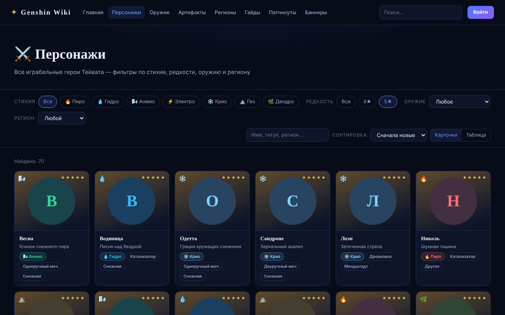

# ✦ Genshin Wiki

Неофициальная фан-энциклопедия по Genshin Impact: персонажи, оружие, артефакты, регионы, патчноуты и баннеры. Данные актуальны на 25.10.2026 (версия игры 7.1).

**Сайт:** https://portfoliobts.github.io/genshin-wiki/



## Возможности

- **121 персонаж, 243 вида оружия, 60 сетов артефактов** из официальной русской локализации игры.
- **Фильтры, которые живут в URL.** Стихия, редкость, оружие, регион, поиск и сортировка; ссылкой с фильтром можно поделиться, кнопка «Назад» работает.
- **Страница каждого персонажа:** таланты во вкладках, созвездия C1–C6 и материалы возвышения. Подробности грузятся отдельным чанком только при открытии страницы.
- **Глобальный поиск в шапке** по персонажам, оружию и артефактам, с управлением с клавиатуры.
- **Патчноуты 6.0–7.1 и текущие баннеры**, сверенные с открытыми источниками; новые персонажи каждой версии подставляются автоматически.
- **Адаптивная вёрстка** с меню-бургером, вид «карточки / таблица», доступность (ARIA-вкладки, combobox, видимый фокус).
- **Демо-аккаунты.** Регистрация с кодом подтверждения и форма «предложить правку». Всё хранится только в браузере, пароли хешируются PBKDF2-SHA-256 (600 000 итераций, соль). Это честное демо, а не настоящая система аккаунтов.

## Стек

- [Vite](https://vite.dev) — многостраничная сборка, общие шапка и подвал подставляются при сборке собственным плагином (`build/partials-plugin.js`).
- Ванильный JavaScript (ES-модули), без фреймворков.
- [Vitest](https://vitest.dev) + jsdom — модульные тесты логики и компонентов.
- ESLint + Prettier.
- GitHub Actions — проверки на каждый push и деплой на GitHub Pages.
- [genshin-db](https://www.npmjs.com/package/genshin-db) — источник игровых данных.

## Быстрый старт

Нужен Node.js 22+.

```bash
npm install
npm run dev        # локальный сервер разработки
npm test           # тесты
npm run lint       # ESLint
npm run build      # сборка в dist/
npm run preview    # просмотр собранного сайта
```

## Как устроен проект

```
├── *.html                 страницы сайта (index, characters, character, weapons, …)
├── partials/              общие <head>, шапка и подвал
├── build/                 плагин Vite для partials
├── src/
│   ├── pages/             модуль на каждую страницу
│   ├── components/        карточки, фильтры, поиск, форма, изображения
│   ├── lib/               чистая логика: фильтры, URL-состояние, поиск, auth
│   ├── data/generated/    JSON из genshin-db (генерируются скриптом)
│   ├── data/content/      вручную написанные регионы, патчи, баннеры, гайды
│   └── styles/            общие стили и стили страниц
├── scripts/data/          скрипт генерации данных (отдельный package.json)
└── tests/
```

## Обновление данных

Игровые данные берутся из пакета `genshin-db`, версия которого зафиксирована в `scripts/data/package.json`. Чтобы обновить базу после нового патча:

1. Поднимите версию `genshin-db` в `scripts/data/package.json`.
2. Запустите `npm run data:update`. Скрипт перезапишет `src/data/generated/`; вывод детерминирован, поэтому в диффе видны только реальные изменения.
3. Если в игре появился новый регион или принадлежность, скрипт остановится с ошибкой `Unknown associationType` — добавьте значение в таблицу `REGION_MAP` в `scripts/data/transform.mjs`.
4. Патчноуты, баннеры и регионы обновляются вручную в `src/data/content/`; источники указаны в начале каждого файла.

## Деплой на GitHub Pages

Workflow `.github/workflows/deploy.yml` публикует сайт при каждом push в `main`. Один раз нужно включить Pages в настройках репозитория: **Settings → Pages → Source: GitHub Actions**.

## EmailJS (необязательно)

Без настройки сайт работает в демо-режиме: код подтверждения показывается на экране, а предложения правок сохраняются только в браузере. Чтобы письма действительно отправлялись:

1. Создайте аккаунт на [emailjs.com](https://www.emailjs.com) и подключите почтовый сервис.
2. Создайте два шаблона:
   - **код подтверждения** с переменными `{{to_email}}`, `{{user_name}}`, `{{code}}`;
   - **предложение правки** с переменными `{{user_name}}`, `{{user_email}}`, `{{page}}`, `{{category}}`, `{{item}}`, `{{message}}`, `{{date}}`. Адрес получателя (администратора) укажите в самом шаблоне.
3. Пропишите ключи:
   - локально — в файле `.env` по образцу `.env.example`;
   - для деплоя — в **Settings → Secrets and variables → Actions → Variables** с теми же именами (`VITE_EMAILJS_PUBLIC_KEY`, `VITE_EMAILJS_SERVICE_ID`, `VITE_EMAILJS_TEMPLATE_VERIFY`, `VITE_EMAILJS_TEMPLATE_PROPOSAL`).

Публичный ключ EmailJS по своей природе виден в браузере, поэтому это переменные, а не секреты.

## Изображения

Иконки и арты загружаются напрямую с CDN HoYoLAB и зеркала enka.network. Если ни один источник недоступен, вместо картинки показывается кружок цвета стихии с первой буквой имени.

## Дисклеймер

Genshin Impact, персонажи, изображения и названия © HoYoverse. Это некоммерческий фан-проект, не связанный с HoYoverse.
